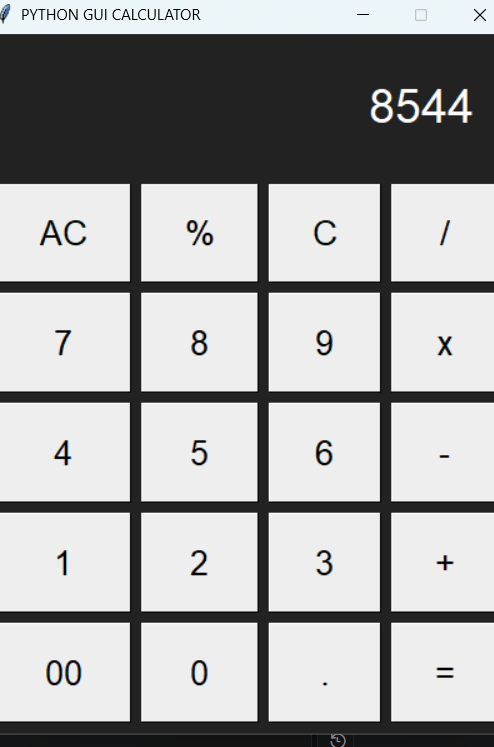

# 🧮 Python GUI Calculator

A simple desktop calculator built with **Python and Tkinter**, featuring a graphical interface and basic arithmetic operations.

<p align="center">
  
  
  
</p>

## ✨ Features

- ➕ Addition, subtraction, multiplication, and division
- 🔢 Decimal number support
- 🧹 Clear (`C`) and All Clear (`AC`)
- 🧮 Modulo operation
- ⚠️ Basic error handling
- 🖥️ Simple desktop graphical interface

## 🛠️ Built With

- Python
- Tkinter
- Git and GitHub

## 🚀 Getting Started

### Prerequisites

- Python 3 installed
- Tkinter available in your Python installation

### Installation

1. Clone the repository:

   ```bash
   git clone https://github.com/devNodeX/python-gui-calculator.git
   ```

2. Navigate to the project directory:

   ```bash
   cd python-gui-calculator
   ```

3. Run the calculator:

   ```bash
   python calculator.py
   ```

## 📸 Preview


<p align="center">
  
</p>

## 📚 What I Learned

- Building desktop interfaces with Tkinter
- Handling button clicks using callbacks
- Managing application state
- Working with Python functions and exceptions
- Using Git and GitHub for version control

## 🔮 Future Improvements

- [ ] Keyboard input support
- [ ] Improved percentage calculations
- [ ] Calculation history
- [ ] Enhanced UI and themes

## 👨‍💻 Author

**devNodeX**

[GitHub Profile](https://github.com/devNodeX)

---

⭐ If you find this project useful, consider giving it a star!
